# LinExplorer

**A Windows 7 Explorer workalike for Ubuntu 24.04 and newer.** Current version: **1.2.2**.

LinExplorer brings back the Windows 7 file window on Linux: the round Back/Forward buttons, the breadcrumb
address bar, the search box, the blue command bar with **Organize**, the navigation pane with **Favorites,
Libraries, Computer, Network and Recycle Bin**, the eight views, the Details and Preview panes, and the familiar
dialogs for copying, conflicts, properties and folder options. On top of that it adds tabs, SAMBA / FTP / SFTP
browsing, tar/gz/bz2/xz archives and a copy engine that stays fast and honest on USB drives.

It was built by studying the resources of the original Windows 7 x64 files (`explorer.exe`, `ExplorerFrame.dll`,
`shell32.dll`, `shellstyle.dll`, `zipfldr.dll`, `propsys.dll`, `ntshrui.dll`, `SearchFolder.dll` and their
English/Greek `.mui` files): menus, accelerators, dialogs, command bar strings and property names. It contains no
Microsoft code or artwork; icons come from your desktop's icon theme and the few UI glyphs are drawn by the
program itself.

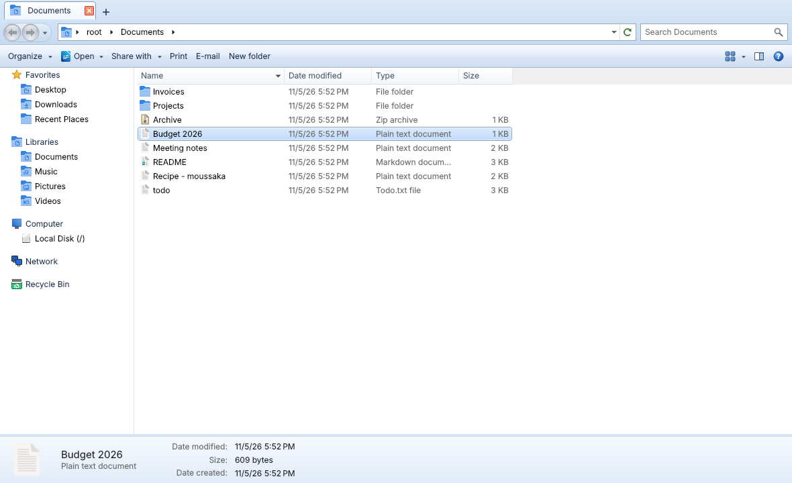

*The Documents folder in Details view, with the Details pane at the bottom.*

## Contents

- [Window and navigation](#window-and-navigation)
- [Tabs](#tabs)
- [Views, sorting and grouping](#views-sorting-and-grouping)
- [Search](#search)
- [Files, copying and menus](#files-copying-and-menus)
- [Recycle Bin](#recycle-bin)
- [Compressed files](#compressed-files)
- [Network: SAMBA, FTP, SFTP](#network-samba-ftp-sftp)
- [Properties and dialogs](#properties-and-dialogs)
- [Languages](#languages)
- [Download and run](#download-and-run)
- [Run from source](#run-from-source)
- [Build the AppImage](#build-the-appimage)
- [Tests](#tests)
- [How Windows 7 concepts map to Linux](#how-windows-7-concepts-map-to-linux)
- [Keyboard shortcuts](#keyboard-shortcuts)
- [License](#license)
- [Changelog](#changelog)

## Window and navigation

- Back/Forward orbs with the Recent Pages drop-down; Up with Alt+Up, Back with Backspace.
- Breadcrumb address bar: click a crumb to go there, click its arrow for the subfolders, click empty space to
  type a path (with completion). Accepts `/path`, `~`, `smb://`, `ftp://`, `sftp://`, `\\server\share`,
  `Computer`, `Libraries`, `Recycle Bin` and `shell:` names. Previous Locations list, Refresh/Go button.
- Command bar that changes with the selection, as in Windows 7: Organize, Open/Preview/Play with the default
  program and an *Open with* list, Include in library, Share with, Print, E-mail, Slide show, Play all, Burn,
  New folder, Empty the Recycle Bin, Restore, Extract all files, System properties, Map network drive, New
  library, Save search … plus Views (slider), Preview pane and Help on the right.
- Hidden menu bar (File, Edit, View, Tools, Help) that appears with Alt or F10, or permanently from
  Organize › Layout.
- Navigation pane with Favorites (drag folders onto it), Libraries, Computer (all drives, including unmounted
  ones), Network and Recycle Bin; hover arrows; *Show all folders* and *Automatically expand to current folder*;
  drop files onto any folder in it; middle-click opens a folder in a new tab.
- Details pane with thumbnail, type and properties; audio tags (title, artists, album, year, genre, track, star
  rating) can be edited in place and saved.
- Preview pane for pictures (GIF animation too), text and source files, PDF, audio and video (with controls),
  fonts, HTML/Markdown and archive contents.
- Library pane ("Documents library – Includes: 2 locations – Arrange by").
- Computer: drives with capacity bars, mount, unmount, eject, format (GNOME Disks), network connections with
  Disconnect.
- One running instance: launching it again opens a new window instantly; *Make LinExplorer the default file
  manager* in Tools.

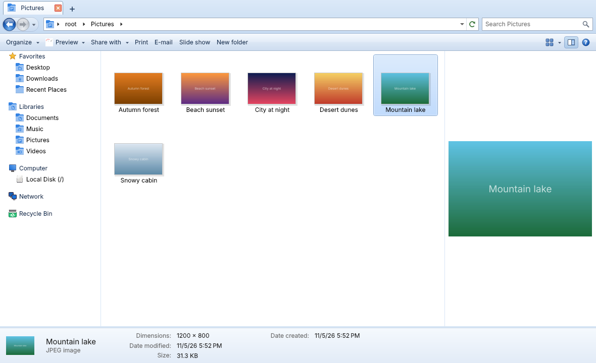

*Pictures in Large icons, with the Preview pane on the right.*

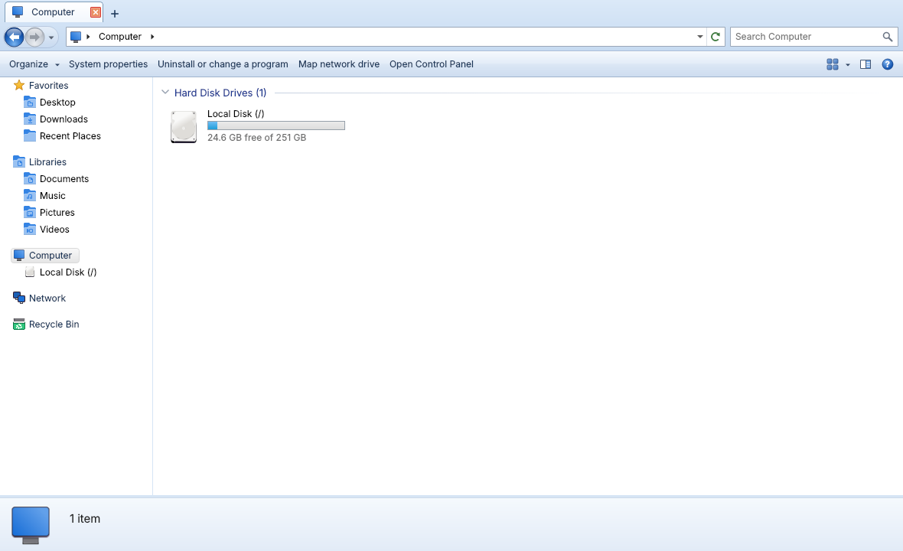

*Computer: drives grouped by type, with capacity bars.*

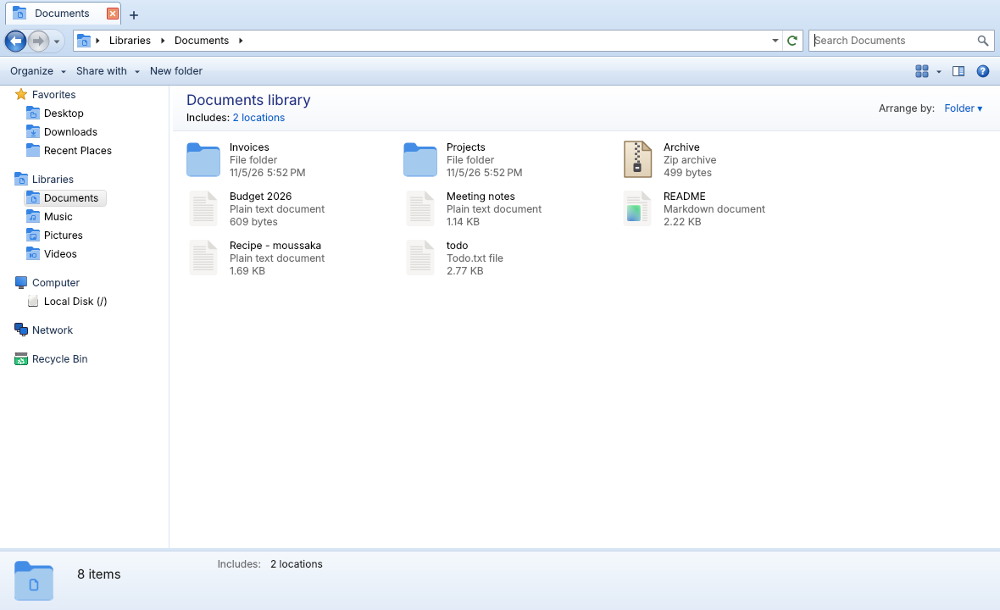

*The Documents library in Tiles view, with the library pane on top.*

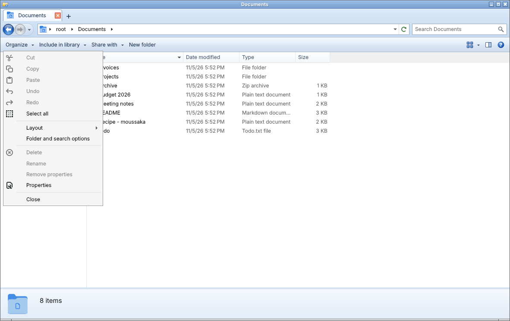

*The Organize menu with Layout, Folder and search options.*

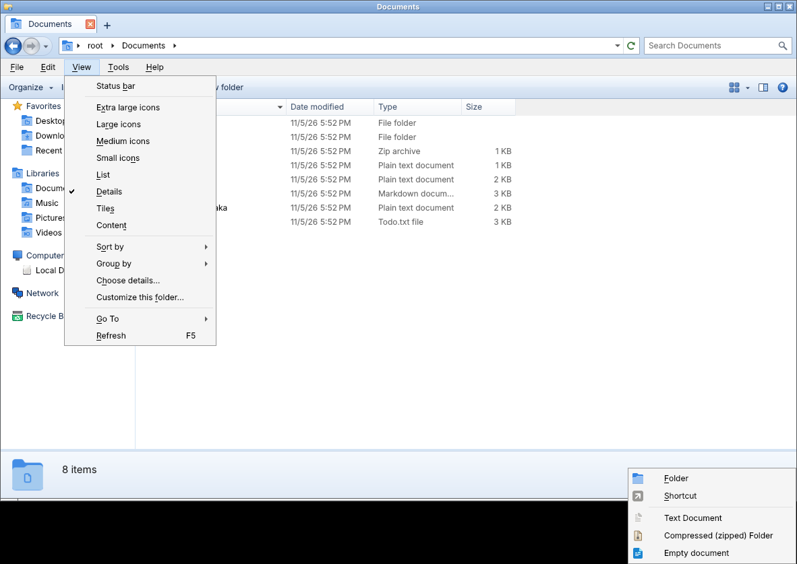

*The classic menu bar (Alt or F10) with the View menu open.*

## Tabs

- Several folders in one window. Ctrl+T new tab, Ctrl+W close tab (the window closes only with its last tab),
  Ctrl+Tab / Ctrl+Shift+Tab switch, Alt+1…9 jump, Ctrl+Shift+T reopen a closed tab.
- *Open in new tab* in every context menu; middle-click a folder to open it in a background tab; double-click
  the empty tab strip for a new tab.
- Drag tabs to reorder; drop files on a tab to copy or move them into its folder (hovering switches to it).
- Tab menu: New tab, Duplicate, Move tab to new window, Close tab, Close other tabs, Close tabs to the right,
  Reopen closed tab.
- Each tab has its own history and view; open tabs are restored with *Restore previous folder windows*.
- Folder Options › View: *Always show the tab bar*, *Open new tabs in the current folder*.

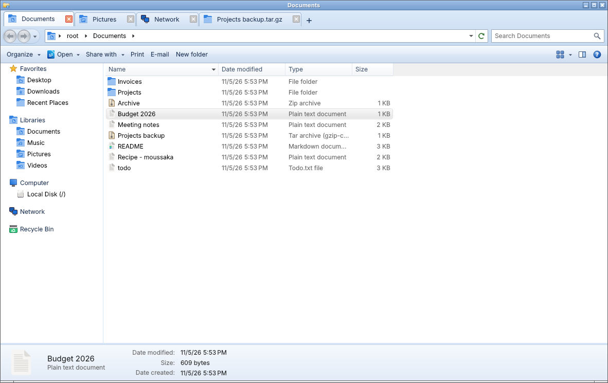

*Four tabs in one window: Documents, Pictures, Network and an archive.*

## Views, sorting and grouping

- Extra large, Large, Medium and Small icons, List, Details, Tiles and Content; Ctrl+mouse wheel and
  Ctrl+Shift+1…8 switch them.
- Thumbnails for pictures, videos (with ffmpegthumbnailer or ffmpeg) and PDFs, shared with the freedesktop
  thumbnail cache that Nautilus uses.
- Sort by and Group by any column (name ranges, date groups such as *Last week*, size groups such as
  *Medium (100 KB – 1 MB)*, type …), collapsible groups, column header menu, Choose Details, per-folder view
  memory, *Apply to Folders* / *Reset Folders*.
- Natural ("logical") order: *file2* before *file10*.
- Windows 7 selection look, translucent rubber band, optional check boxes, type-to-select.
- Shift+arrow keys, Shift+Home/End/Page Up/Page Down and Shift+click select ranges in the shown order (also
  across groups); Ctrl+Shift adds a range; Ctrl+click toggles single items.

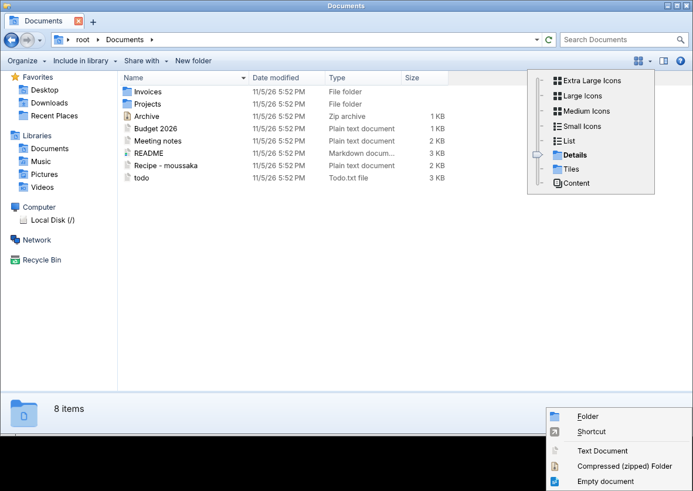

*The Views slider in the command bar.*

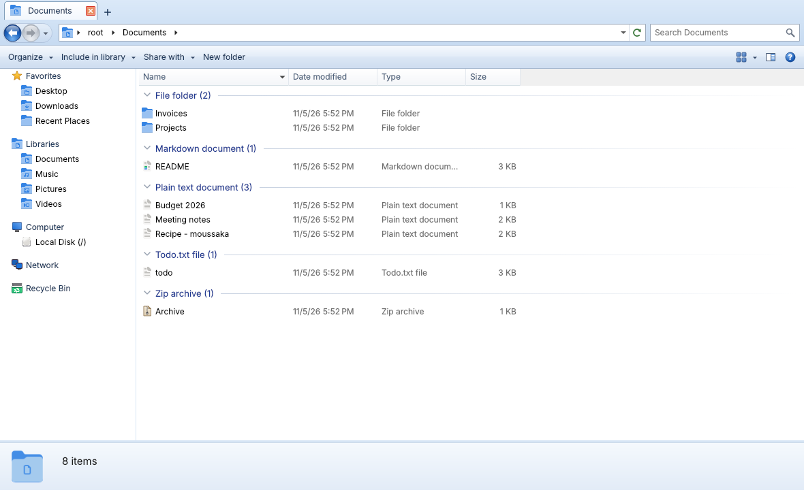

*Documents grouped by type, with collapsible group headers.*

## Search

- The search box searches the current folder and its subfolders while you type, with recent searches and
  **Add a search filter** (Kind, Date modified, Type, Size).
- Windows 7 query syntax in English and Greek: `kind:`, `type:`/`ext:`, `datemodified:` (words, ranges,
  comparisons), `datecreated:`, `size:` (buckets, `>10MB`), `name:`, `content:`; optional search inside archives.
- Search-term highlighting in the results; *Save search* creates a `.lxsearch` file.

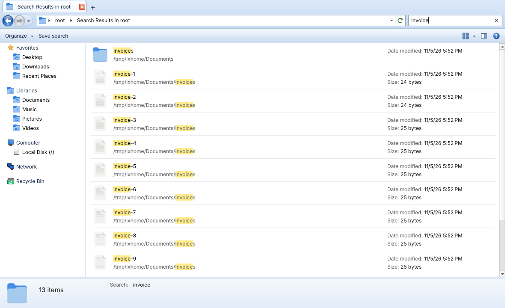

*Search results in Content view, with the matches highlighted.*

## Files, copying and menus

- Copy, cut, paste (desktop clipboard compatible with Nautilus and Dolphin), drag and drop with the Windows rules
  (same drive = move, other drive = copy, Ctrl = copy, Shift = move, Alt = shortcut, right-drag menu).
- **Copying adapts to the destination**, so large copies do not start fast and then freeze as with `cp` or Caja:
  - same file system: reflink (instant on btrfs/XFS) or in-kernel `copy_file_range`;
  - USB and other removable drives: write-back started every 32 MB and waited for one window later, then a final
    flush, so the speed stays steady, the progress bar shows what is really on the device, the system stays
    responsive and the drive can be removed as soon as the copy ends;
  - NTFS/exFAT through FUSE and network folders: 8 MB chunks with periodic flushing;
  - the source file is dropped from the cache, so copying many GB does not push other programs out of memory.
- Windows 7 progress dialog with *More details* (name, from, to, time and items remaining, speed), the conflict
  dialog (*Copy and Replace / Don't copy / Copy, but keep both files*, *Do this for the next N conflicts*), folder
  merge confirmation, error dialog with Try Again / Skip.
- Multi-level Undo/Redo (rename, copy, move, delete, new folder, shortcuts, restore).
- Rename in place (the extension stays out of the selection); New ▸ Folder / Shortcut / Text Document /
  Compressed (zipped) Folder / your Templates, with the name box kept open until Enter or Esc; Create shortcut
  (symbolic link); Send to (Compressed folder, Desktop, Documents, Mail recipient, removable drives, plus a
  SendTo folder); Copy to folder / Move to folder; Copy as path.
- Open with dialog (Recommended / Other programs, *Always use the selected program*), executable files and scripts
  (Run / Run in Terminal / Display), `.desktop` launchers.

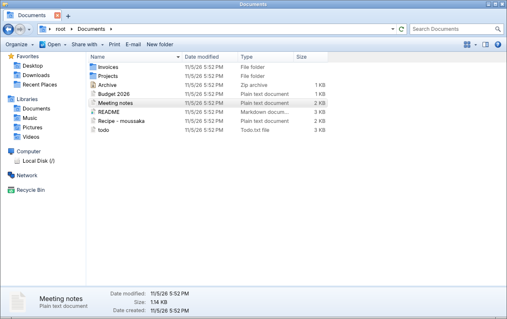

*The context menu of a file.*

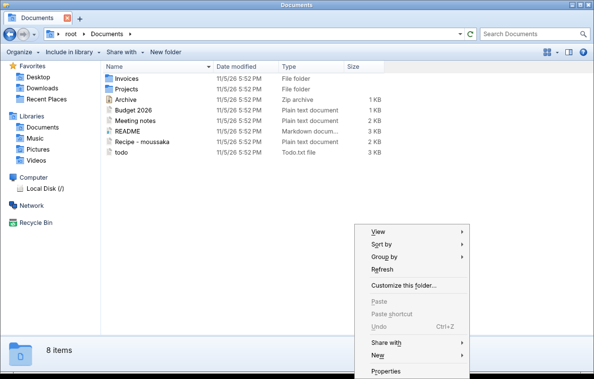

*The background menu of a folder, with View, Sort by, Group by and New.*

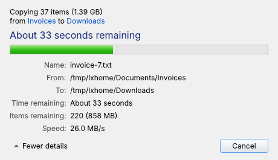

*The copy progress dialog with More details.*

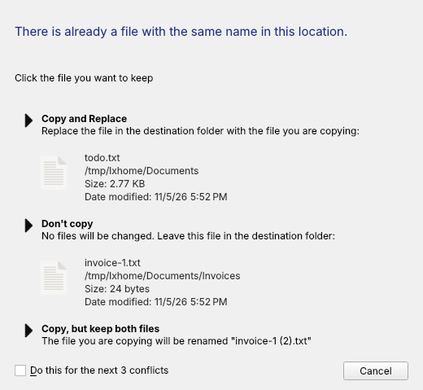

*The conflict dialog: Copy and Replace, Don't copy, or Copy but keep both files.*

## Recycle Bin

- The freedesktop Trash (home and per-drive) as the Recycle Bin, in the navigation pane with a full/empty icon,
  an item-count tooltip and drop-to-delete.
- Its menu in the navigation pane: Open (also in a new tab or window), Restore all items, Empty the Recycle Bin,
  Properties (confirmation dialog, delete immediately).
- Inside it: Original Location and Date Deleted columns; Restore (to the original place), Restore to… (a folder
  you choose), Open original location, Delete permanently; cutting and pasting an item restores it where you
  paste.
- Folder Options › General › *Show the Recycle Bin* hides or shows it in the navigation pane.

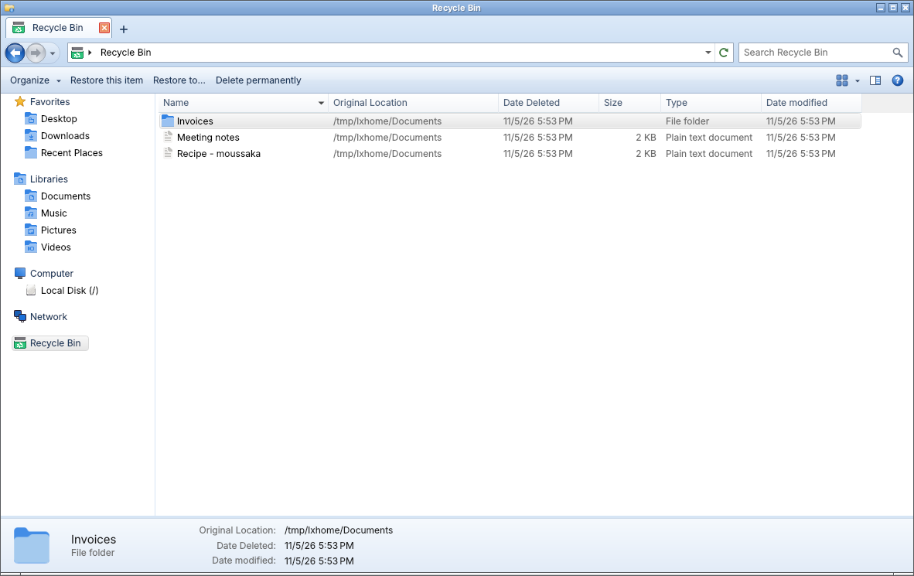

*The Recycle Bin, with each item's original location and date deleted.*

## Compressed files

- zip, tar, tar.gz/tgz, tar.bz2/tbz, tar.xz and single gz/bz2/xz files open like folders: open files inside,
  copy out, add files into zip and tar archives (drag & drop or paste), delete inside.
- *Extract All…* wizard, *Extract Here*, *Extract to "name"*; *Add to archive…* creates any of these formats.
- Paths that would escape the destination are refused; `.tar.gz` counts as one extension when renaming.

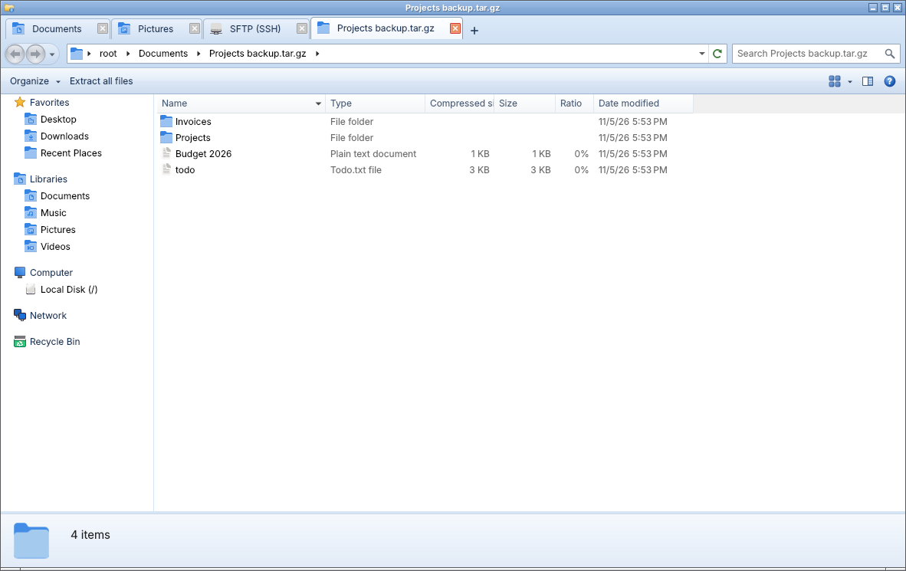

*Inside a `.tar.gz` archive, with compressed size, size and ratio.*

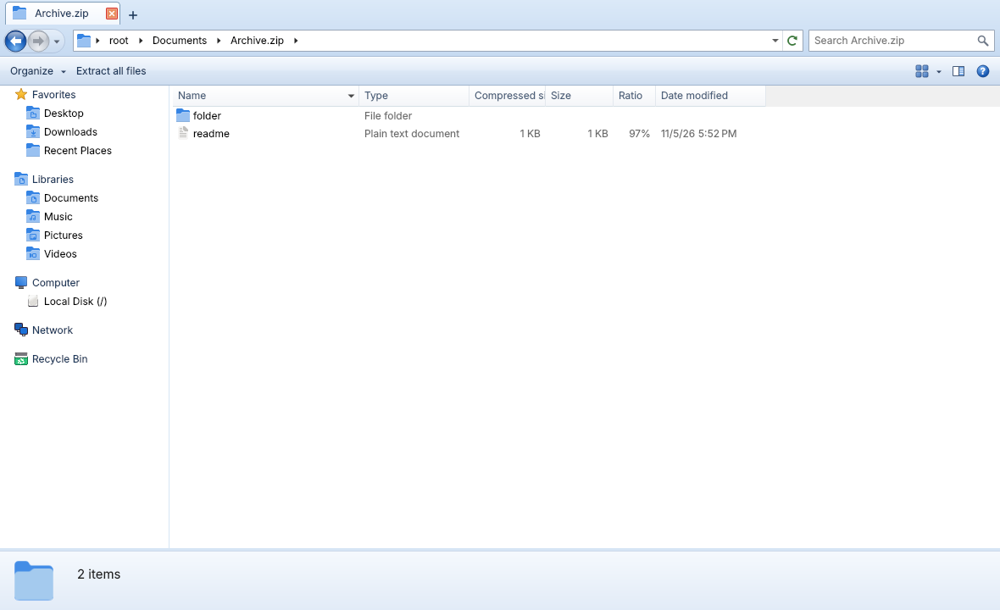

*Inside a ZIP archive.*

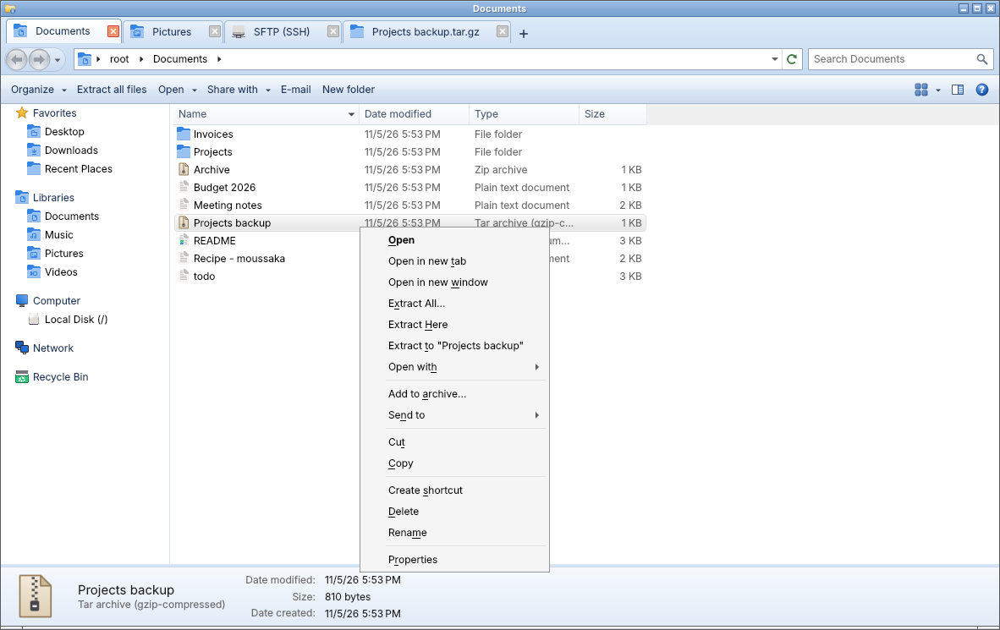

*The context menu of an archive: Extract All, Extract Here, Extract to, Add to archive.*

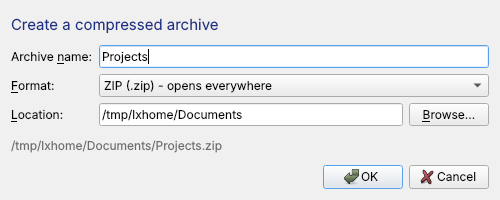

*The Add to archive dialog: name, format and location.*

## Network: SAMBA, FTP, SFTP

- Network opens on *SAMBA (Windows Network)*, *FTP* and *SFTP (SSH)*. Each lists its connected servers, your
  saved locations and the servers announced on the LAN (Avahi/Zeroconf, SMB browsing).
- *Add a network location*: SAMBA, FTP, FTP over TLS (explicit), FTPS with implicit TLS, SFTP, WebDAV; server,
  port, folder, user, anonymous. With *Connect now* the location is saved only when the connection works.
- Connections use GIO (gvfs); user name, domain, password and certificate/host-key questions are asked in
  LinExplorer's own dialogs. A plain `ftp://` login refused by a server that requires TLS is retried as
  `ftps://` automatically.
- Servers that gvfs cannot list (for example FileZilla Server, which answers gvfs with "Operation failed") are
  opened with LinExplorer's **built-in FTP/FTPS client**: plain FTP, explicit and implicit TLS, TLS session
  resumption, MLSD with LIST fallback, self-signed certificates trusted by their SHA-256 fingerprint.
- In remote folders: open files, Download to…, upload by drag & drop or paste, New folder, Rename, Delete.
- Connect, Disconnect and Force disconnect everywhere a connection appears (Computer, navigation pane, Network,
  the folder itself, Tools › Disconnect network drive); Force disconnect all; Rename / Remove saved locations,
  Remove all saved locations; Copy address. Stale gvfs connections are listed so they can be closed.
- Map network drive with *Reconnect at sign-in*.

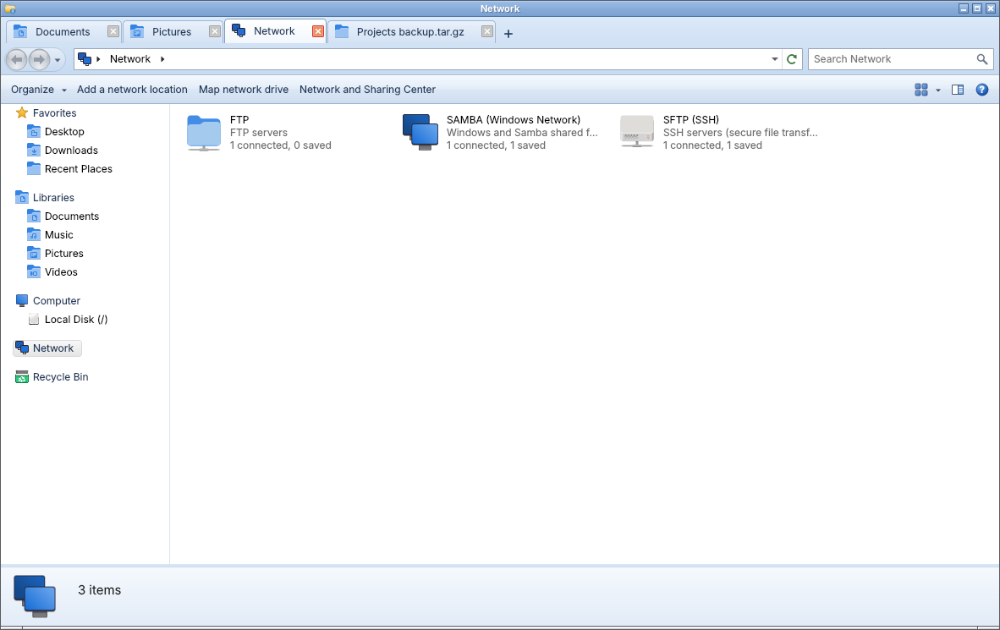

*Network: one tile per protocol, with its connected and saved locations.*

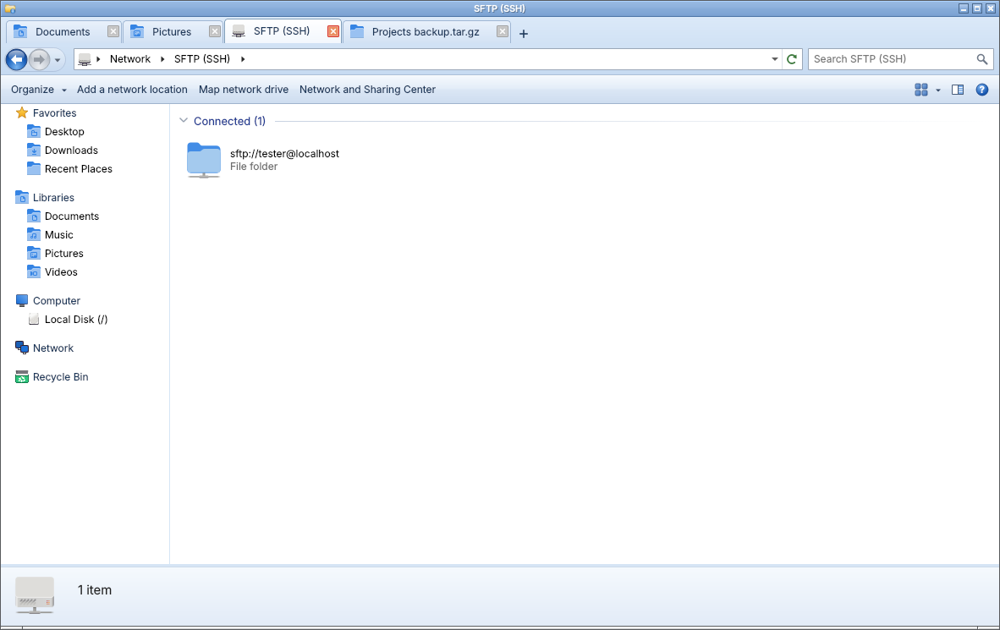

*The SFTP (SSH) view with a connected server.*

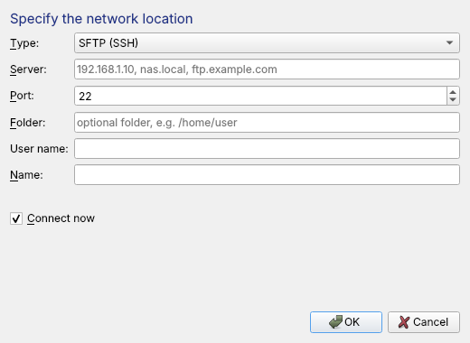

*The Add a network location dialog.*

## Properties and dialogs

- Properties: General (Opens with › Change…, sizes and size on disk, Read-only/Hidden), Security (Linux
  permissions), Details (EXIF, audio/video, PDF and office properties; editable tags; *Remove Properties and
  Personal Information*), Shortcut, Sharing (Samba user shares), Customize (optimize folder for, folder picture,
  folder icon); drives with the pie chart, Tools and Hardware tabs; several items at once.
- Libraries: Documents, Music, Pictures, Videos and your own, with locations, save location and optimization.
- Folder Options: General, View (all Advanced settings) and Search.

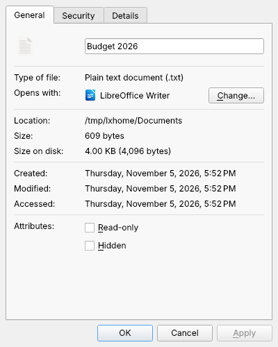

*File properties, General tab.*

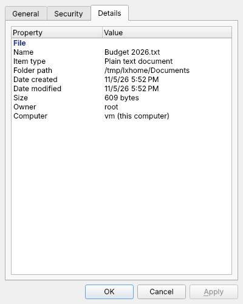

*File properties, Details tab.*

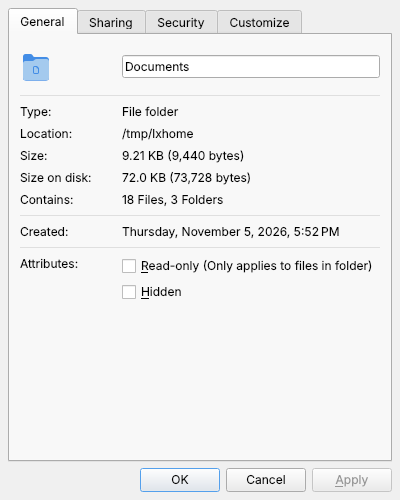

*Folder properties with the Sharing, Security and Customize tabs.*

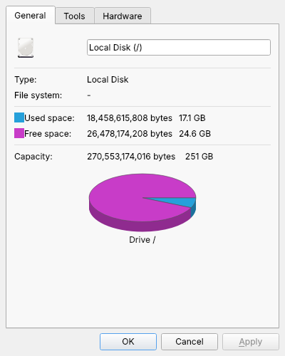

*Drive properties with the used/free pie chart.*

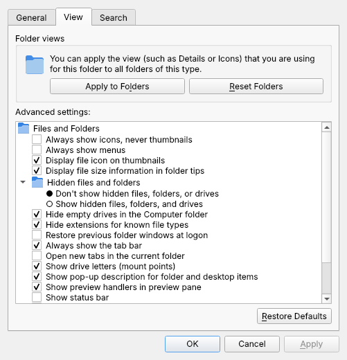

*Folder Options, View tab with the Advanced settings.*

## Languages

English and Greek user interface (Folder Options › General › Language, or automatic from the system). The Greek
terms come from the Greek Windows 7 resources.

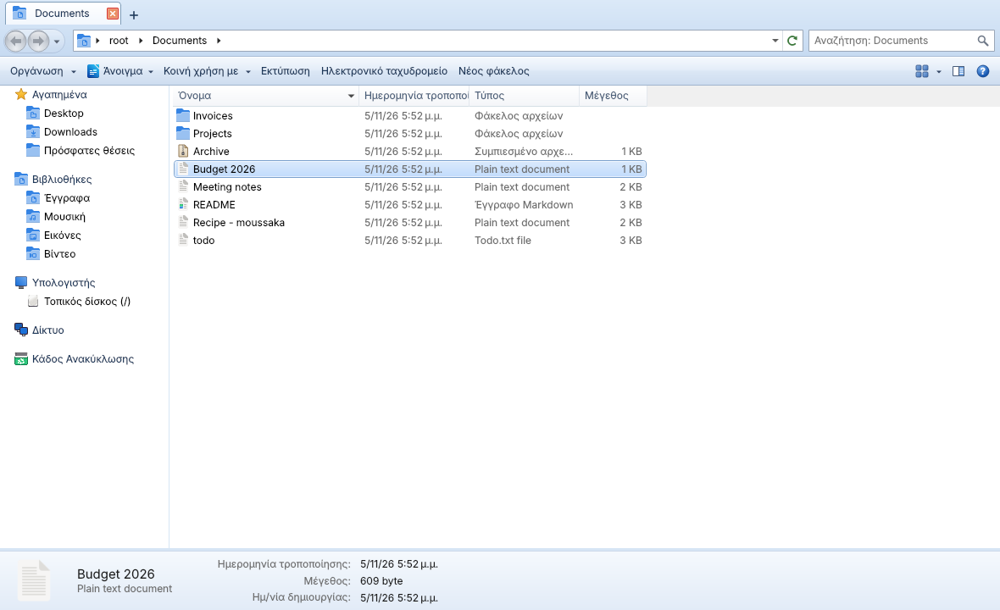

*The Documents folder with the Greek interface.*

## Download and run

Download `LinExplorer-1.2.2-x86_64.AppImage` (and, if you want to verify it, its `.sha256` file) from
[Releases](https://github.com/demosthenesk/LinExplorer/releases/latest), then:

```bash
sha256sum -c LinExplorer-1.2.2-x86_64.AppImage.sha256   # optional check
chmod +x LinExplorer-1.2.2-x86_64.AppImage
./LinExplorer-1.2.2-x86_64.AppImage                     # or: ./LinExplorer-1.2.2-x86_64.AppImage ~/Documents
```

The AppImage (about 50 MB) bundles Qt 6.8 (PySide6) and runs on the system's Python 3 (3.9 or newer; Ubuntu 24.04
has 3.12). Optional helpers it uses when present:

- `gio` with gvfs-backends: SAMBA / FTP / SFTP / WebDAV;
- `avahi-browse`: server discovery;
- `ffmpegthumbnailer` or `ffmpeg`: video thumbnails;
- `udisksctl`: mounting drives;
- `net` from Samba: folder sharing;
- `lp`: printing; `xdg-email`: E-mail;
- Brasero / Xfburn / K3b: burning; GNOME Disks; Disk Usage Analyzer.

Command line: `linexplorer [PATH|URI|shell:computer …] [--select FILE] [--new-window]`; the Windows forms
`/select,FILE` and `/e,PATH` work too.

## Run from source

```bash
sudo apt install python3-pip
pip install --user PySide6==6.8.1 mutagen
./run.sh
```

## Build the AppImage

On Ubuntu 24.04:

```bash
sudo apt install python3-pip curl unzip binutils libxcb-cursor0 libxcb-icccm4 libxcb-keysyms1 \
    libxcb-image0 libxcb-render-util0 libxkbcommon-x11-0
packaging/build-appimage.sh                   # output in dist/
```

## Tests

| Script | What it checks |
|---|---|
| `tests/make_demo.py DIR` | builds a demo home folder (pictures, documents, archives, audio, a shortcut, a template) |
| `tests/ui_smoke.py [en\|el]` | views, grouping, sorting, every location type, file operations, undo/redo, menus, dialogs, keyboard |
| `tests/ui_features.py [en\|el]` | tabs, archives, Shift selection in every view, naming a new folder, Recycle Bin; network with `LX_NET_TEST=1` |
| `tests/net_ftp_tls.py` | FTP, FTPS (explicit, implicit, session resumption), the built-in FTP client, disconnect, saved locations |
| `tests/copy_engine.py` | copy strategies per destination, bounded dirty memory on removable drives, NTFS, cancel |
| `tests/shots.py`, `tests/shots_features.py` | the screenshots in this README |

Run the UI tests on X11 (for example `Xvfb :99` + `openbox`) with `HOME` pointing at a demo home:
`HOME=/tmp/lxhome DISPLAY=:99 python3 tests/ui_smoke.py en`.

## How Windows 7 concepts map to Linux

| Windows 7 | LinExplorer on Linux |
|---|---|
| Recycle Bin | freedesktop.org Trash (`~/.local/share/Trash`, `.Trash-UID` on other drives) |
| Shortcut (.lnk) | symbolic link (`name - Shortcut`) |
| Hidden attribute | the folder's `.hidden` file (dot-files are always hidden) |
| Read-only attribute | write permission bits |
| Security tab (ACLs) | owner / group / others permissions |
| Libraries (.library-ms) | `~/.config/LinExplorer/libraries/*.json` |
| Network sharing | Samba user shares (`net usershare`) |
| Map network drive, Network | GIO / gvfs mounts, plus the built-in FTP/FTPS client |
| Compressed (zipped) folders | zip and the tar family, gz, bz2, xz |
| Drive letters | mount points |
| desktop.ini folder customization | LinExplorer's folder settings (+ `metadata::custom-icon` for Nautilus) |
| Saved searches (.search-ms) | `.lxsearch` files |

Not carried over: Homegroup, Previous Versions, BitLocker, Offline Files/Sync Center and third-party shell
extensions.

## Keyboard shortcuts

| Keys | Action |
|---|---|
| Alt+Left, Backspace / Alt+Right / Alt+Up | Back / Forward / Up |
| Alt+D, Ctrl+L, F4 | Address bar |
| F3, Ctrl+E, Ctrl+F | Search box |
| F5, Ctrl+R | Refresh |
| F2 | Rename |
| F6 | Move between panes |
| Alt, F10 | Menu bar |
| F11 | Full screen |
| Alt+P | Preview pane |
| Alt+Enter | Properties |
| Ctrl+N / Ctrl+Shift+N | New window / New folder |
| Ctrl+T / Ctrl+W | New tab / Close tab |
| Ctrl+Tab, Ctrl+Shift+Tab, Ctrl+PgDn, Ctrl+PgUp | Next / previous tab |
| Alt+1…9 | Go to tab (Alt+9 = last) |
| Ctrl+Shift+T | Reopen closed tab |
| Ctrl+C / Ctrl+X / Ctrl+V | Copy / Cut / Paste |
| Ctrl+Z / Ctrl+Y | Undo / Redo |
| Delete / Shift+Delete | Delete to the Recycle Bin / permanently |
| Ctrl+A | Select all |
| Shift+arrows, Shift+Home/End, Shift+click | Select a range |
| Ctrl+Shift+1…8 | Views |
| Ctrl+Shift+E | Expand the navigation pane to the current folder |
| Shift+right-click | Adds *Copy as path* and *Open terminal here* |

## License

MIT. See [LICENSE](LICENSE).

## Changelog

- **1.2.2** (2026-11-05): Shift+arrow keys, Shift+Home/End/Page Up/Page Down and Shift+click select ranges as in
  Windows in every view (they selected nothing in Details and too little in Tiles); the range follows the shown
  order, also across groups; Ctrl+Shift adds the range to the selection.
- **1.2.1** (2026-11-05): New folder (and New text document, rename with F2) keeps its name box open and the item
  selected until you press Enter or Esc: folder refreshes that arrive while you type are held back instead of
  closing the editor and leaving the default name.
- **1.2.0** (2026-11-05): adaptive copy engine (reflink / in-kernel copy on the same file system; throttled
  write-back and a final flush on USB and other removable drives; 8 MB chunks with periodic flushing for
  NTFS/exFAT and network folders; the source is dropped from the cache). Recycle Bin in the navigation pane
  (full/empty icon, item count, drop to delete, Open, Restore all, Empty, Properties; can be hidden), and in the
  Recycle Bin: Restore to…, Open original location, Delete permanently.
- **1.1.4** (2026-11-05): built-in FTP/FTPS client for servers that gvfs cannot list (e.g. FileZilla Server):
  plain FTP, explicit and implicit TLS, TLS session resumption, MLSD with LIST fallback, trust of self-signed
  certificates; browse, open, download, upload, new folder, rename and delete in remote folders.
- **1.1.3** (2026-11-05): Force disconnect, Force disconnect all, Remove all saved locations; stale connections
  listed; saved locations managed from the navigation pane; locations saved only after a successful connection.
- **1.1.2** (2026-11-05): Disconnect everywhere a connection appears; disconnect by address, so it works when the
  gvfs folder is unreadable; tabs inside the connection move to Network first; forced disconnect after
  confirmation.
- **1.1.1** (2026-11-05): FTP over TLS (explicit and implicit) and automatic ftp→ftps retry; GIO browsing when
  the gvfs FUSE folder fails ("Input/output error"), with the server's real error message otherwise.
- **1.1.0** (2026-11-05): tabs; Network split into SAMBA / FTP / SFTP with saved locations, discovery and an
  interactive GIO login; tar, tar.gz, tar.bz2, tar.xz, gz, bz2 and xz archives.
- **1.0.0** (2026-11-05): first release.
